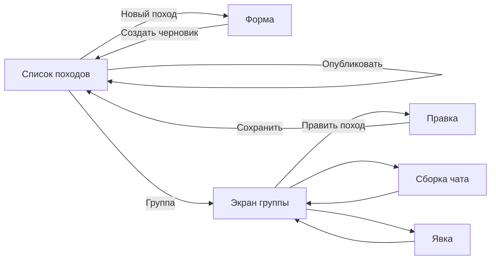

# Проход по экранам

> **Статус на 14 сентября 2026: проход закрыт.** Всё из сводки сделано,
> выкачено и проверено автором с телефона. Что именно — разделы «… —
> сделано 14 сентября 2026» в конце файла; сквозные правила переехали в
> `docs/UI.md`. Абзацы ниже про «решений пока нет» и «код не меняется» —
> история того, как проход шёл, а не текущее правило. Следующий шаг — в
> `docs/ROADMAP.md`, «С чего начинать следующую сессию».

> Рабочий документ UX-прохода, начат 13 сентября 2026. `SCREENS.md` отвечает
> на «что лежит на экране», этот — на «как между экранами ходят и где на этом
> пути спотыкаются». Собран из кода, без входа на сайт: всё, что ниже помечено
> «проверить», видно только глазами с телефона.
>
> **Способ работы — решение автора 13 сентября 2026.** Пересматриваем каждый
> экран целиком, не только путь по задаче: зачем он, главное действие, что
> лишнее, что не на месте, как выглядит, следует ли общей стилистике.
> Наблюдения копятся в разделе «Наблюдения по экранам» с пометкой
> «склоняемся», сквозные правила — в «Кандидатах». **Окончательных решений и
> правок вёрстки нет, пока не пройдены все экраны:** правило, придуманное по
> трём экранам, седьмой может перевернуть. Исключение — настоящие баги, они
> чинятся сразу. Автор присылает скриншоты с телефона, порядок задач ниже
> остаётся порядком прохода. Находку, которую решили не трогать, не удалять, а
> помечать «оставляем, потому что…» — иначе её найдут заново.

## Сводка к решению — 13 сентября 2026

Пройдены все 21 экран: скриншоты автора с телефона плюс сверка с кодом там,
где глазами не увидеть (лист ожидания, сводка с заявками). Ниже — не
решения, а то, что решать. **Код по этой сводке не меняется, пока автор не
ответит по пунктам.** Подробности каждого пункта — в разделах ниже.

> **Рамка задачи — решение автора 13 сентября 2026.** Цель — сайт, которым
> приятно пользоваться и участникам, и лидерам: чётко, красиво, продуманно.
> Пересматривать можно не только экраны, но и саму визуальную систему —
> цвета, шрифты, компоненты, правила `UI.md` и `DESIGN.md`, — если иначе
> получается лучше. Мелочи вроде «Место за тобой» над карточкой похода —
> тоже предмет прохода, а не шум. Действующие правила — отправная точка, а
> не ограничение: предлагая отступить от них, объяснять, чем новое лучше.

### Визуальная система — что видно по скриншотам

Наблюдения по всему сайту сразу, а не по экрану. Здесь больше всего
пространства для «красиво», и здесь же решения дороже всего менять потом.

- **Акцент потерял смысл.** По `UI.md` §7 оранжевый — действие и активное
  состояние. На деле им набраны даты на карточках, «Осталось 1 из 2», цифры
  лендинга, маркеры списков, плашка «Можно новичкам», ссылки и главные
  кнопки. Когда оранжевое всё, оно ничего не выделяет: главную кнопку
  приходится искать среди оранжевых дат.
- **Заголовки слишком тяжёлые.** Unbounded жирным стоит на каждом уровне — от
  героя до «Данные» и «Ведут — 4». Широкий шрифт на телефоне переносит
  короткие заголовки в две строки («Правила и безопасность», «Погода в день
  похода, 2250 м») и кричит там, где нужно подписать блок. Кандидат:
  Unbounded — только герой и заголовок страницы, заголовки секций — Manrope.
- **Подложки почти не отличаются от фона.** Карточка `ink-900` на фоне
  `ink-950` с тонкой рамкой; внутри карточки ещё карточка (анонс, подсказки).
  Глаз не видит, где кончается один блок и начинается другой, и рамки
  работают за контраст.
- **Полупрозрачные оттенки выглядят грязными.** Выбранный вариант, плашка
  «Можно новичкам», предупреждение, неактивная главная кнопка — все дают
  коричневый: оранжевый или жёлтый на тёмном превращается в бурый. Отсюда
  ощущение «мутного» интерфейса на скриншотах снаряжения и приёма.
- **Статус оторван от того, к чему относится.** «Место за тобой», «В очереди»
  зелёной или серой строкой *над* карточкой похода в ленте и профиле; «в
  чате» — отдельной плашкой рядом с именем, «гость» — серым текстом рядом с
  ней. Состояние объекта — часть его карточки.
- **Серые стены текста.** Большая часть экранов — абзацы `fg-muted` базового
  размера: вступления, подсказки, пояснения. Серый крупный текст на тёмном
  читается тяжело и уравнивает важное с фоном.
- **Карточки похода разного веса.** С обложкой — крупная фотография на всю
  ширину, без обложки — плотный текстовый блок; в одном списке они выглядят
  как два разных компонента.

Кандидаты в решения здесь не записаны намеренно: это решается глазами, на
макетах ключевых экранов, а не списком.

### Три причины почти всего найденного

1. **Экраны не знают состояния.** Экран похода одинаков у черновика,
   набора, дня выхода и прошедшего; страница похода зовёт «К записи»
   записанного и пишет «Осталось 25 из 25» до открытия записи; у будущего
   похода загрузка фото, у прошедшего — красное «убрать из чата». Одна
   причина, десяток симптомов.
2. **Правила в `UI.md` есть, код нарушает их в новых местах.** Две главные
   кнопки на экране, вкладки подсвечены главной кнопкой вместо `selected`,
   опасные действия набраны ссылками-призраками. Каждый экран делался по
   правилам своего дня — сводить их никто не возвращался.
3. **Тексты.** Много объяснений, мужской род по умолчанию, одно и то же
   называется по-разному, служебные строки показаны людям, и местами текст
   спорит с поведением («подтвердится само» над 243 кнопками «Подтвердить»).

### 1. Правила, которые уже есть в `UI.md` — код нарушает

Эти правила приняли раньше, и сводить к ним код — работа почти без решений.
Но после решения автора о рамке задачи они тоже не догма: если макеты
визуальной системы покажут, что иначе лучше, сначала меняется правило, потом
код — а не код в обход правила.

- **Одна главная кнопка на экран (§5).** Нарушают: «Войти» в шапке рядом с
  «Ближайшие походы» на лендинге; «Подтвердить» у каждого из 243 гостей;
  «Скачать расписку» вместе с плавающей «К записи»; «Группа» акцентом в
  каждой строке списка походов.
- **Нажатое состояние — `selected: true` (§5).** Нарушают вкладки
  «Ближайшие / Прошедшие»: активная залита как главная кнопка. Выбранная
  физическая форма в анкете отмечена своей рамкой, мимо `buttonClass`.
- **Необратимое — `danger`, `ghost` — только «назад» и «отмена» (§5).**
  Нарушают «Снять с похода», «Отменить поход», «Отменить запись», «Убрать»
  лидера и бланка — всё ссылками-призраками. Съехавший вправо отступ у всех
  этих ссылок — внутренний отступ `ghost`, то есть уйдёт вместе с
  нарушением.
- **Цель нажатия не меньше 44px (§6)** — проверить текстовые ссылки
  «Подробнее», «снять», «Поправить» после сведения.

И одно, где решение уже записано и наблюдение с ним спорит:

- **Вход без шапки — исключение из §1, сделано намеренно.** Предупреждение
  про адрес Google набрано крупно тоже намеренно (§3): оно снимает страх «меня
  уводят не туда». Предлагаю не трогать, а переписать саму фразу без слов
  «наша база данных».

### 2. Новые правила — предлагаю дописать в `UI.md`

- **Статус и фаза.** Статус объекта виден на каждом его экране. Экран похода
  собирается по фазе: черновик → набор → день выхода → прошёл или отменён; в
  каждой фазе видно то, что в ней делают, остальное свёрнуто или убрано.
- **Ссылки — два смысла.** Действие — акцентом; раскрытие и второстепенное —
  `fg-muted`. Красных ссылок нет: опасное — кнопкой `danger`.
- **Неактивная кнопка выглядит выключенной**, а не отдельным
  тёмно-коричневым цветом.
- **Ширина кнопок.** В карточке и форме на телефоне — во всю ширину,
  стопкой; по содержимому — только в строке списка.
- **Длинный список сворачивается** по образцу явки и сборки чата:
  отменившиеся, «В чате», отмеченные — под раскрытие.
- **Плавающая кнопка** оставляет под собой место на странице, знает
  состояние и не ведёт туда, где нечего нажать.
- **Одна модель сохранения на экран.** Длинная форма держит кнопку на виду
  или сохраняет сразу.
- **Две колонки — только для коротких значений.** Категория и даты записи в
  них не помещаются.
- **Выбор файла — своей кнопкой** с русской подписью. Дату оставляем
  нативной — решение в `CLAUDE.md`.

### 3. Правила для текстов — предлагаю завести раздел в `UI.md`

- **Без рода:** «Отмена 13 сентября», «Не пришли», «Ты в списке» — а не
  «Отменил», «не пришёл», «Ты записан», «Согласен», «Его телефон».
- **Одно название на одну вещь:** раздел — «Управление» (не «Админка»);
  страница — «Что взять с собой» (не «Список снаряжения»); очередь — «лист
  ожидания, 3-й» везде; «до категории 3» везде; «Вступить в клуб» — и на
  кнопке, и на экране.
- **Служебное людям не показываем:** адрес похода на правке, служебное имя
  файла бланка, «база данных» на входе.
- **Подсказка — одна строка, инструкция экрана — одна строка или под
  раскрытие.** Сейчас абзацами в пять строк на каждом заходе: сборка чата,
  бланки, приём, «Что взять с собой».
- **Текст над кнопками говорит о главной кнопке.** Экран ошибки не
  утверждает причину, которой не знает.
- **Один язык:** роли в «Команде» — по-русски.

### 4. Переделки экранов — по приоритету

**Первое — экраны лидера,** на них работают каждую неделю.

1. **Экран группы:** по фазам, со статусом; публикация и снятие с публикации
   здесь, с подтверждением; «Ведут» — один блок вместо двух; ссылка на
   публичную страницу похода. Находки 2, 3, 5, 6.
2. **Создание и правка:** после сохранения — в группу похода, а не в список;
   форма смысловыми блоками, «Открыт для новичков» наверх; редактор лидеров
   отделён от формы так, чтобы разница в сохранении была видна. Находки 1, 9.
3. **Список походов:** ближайшие сверху; в строке одно главное действие;
   снятие с публикации отсюда уходит.

**Второе — путь новичка,** на нём держится набор.

4. **Лента вошедшего и квест:** что заполнить и куда записаться, пока ничего
   не сделано; нормальное имя вместо ника из Google; «У меня есть код клуба»
   из верха профиля гостя — вниз.
5. **Страница похода:** всё про запись в одном месте, рядом с кнопкой;
   «Осталось N» — только когда запись открыта; «из них 5 лидеров» — не при
   нуле участников; «К записи» по состоянию.
6. **Лендинг:** одна главная кнопка; карусель в «Как это выглядит»; место под
   плавающую кнопку; «Команда» — русские роли и нормальная заглушка вместо
   фото.

**Третье — редкие экраны админа.**

7. **Полоса админки** выделяет текущий раздел; «Бланки расписки» — в полосу
   или ссылкой из похода.
8. **Справочник:** строка человека вдвое ниже; фильтр «Участники» назвать
   иначе, чем страницу.
9. **Приём в клуб:** гости без главных кнопок и свёрнуты; «скопировать все» у
   номеров из группы; подписи у полей кода; иностранные номера с пробелами.
10. **Бланки:** человеческое имя и возможность открыть загруженное.

**Пачкой в конце — мелочи:** галочка «родитель» в цвет акцента, «Где уже
был» в одну строку, телефон с пробелами в поле анкеты, курс выбором из
четырёх, вещи в анкете снаряжения по категориям, свои отметки на «Что взять с
собой» у вошедшего.

### 5. Вопросы, которые решает автор

1. **Категория и «Можно новичкам».** Лендинг: «начинают с первой, каждая
   следующая открывается опытом». Оба ближайших похода — категория 3 с
   плашкой «Можно новичкам». Что правда: лидер вправе открыть новичкам любую
   категорию (тогда меняем текст лендинга) или плашка разрешена только до
   какой-то категории (тогда форма это держит)?
2. **«Открыт для новичков» по умолчанию** — включить?
3. **Экран группы по фазам** или стабильный порядок со сворачиванием?
   Фазы понятнее в моменте, стабильный порядок не перестраивается под рукой.
4. **Сводка `/admin` лидеру нужна** или его стартовая — список походов?
5. **Удаление черновиков:** нужно ли, и кому — автору черновика, пока на него
   никто не записан?
6. **Цифры лендинга:** «участники» — это подтверждённые члены (36) или все,
   кто хоть раз ходил?
7. **Имена:** спрашивать имя и фамилию при первом входе вместо ника из
   Google?
8. **Членство:** разбирать в одном месте — где?
9. **Бланк расписки:** PDF вместо `.docx`?
10. **Карусель:** оставлять ли в ней пейзажи без людей?
11. **Лидер младше 18:** что для ведущего значит плашка «нужен родитель»?
12. **Ошибка без входа:** какое действие ты сделал — без этого место не
    найти.

#### Ответы автора — 14 сентября 2026

1. **Лидер вправе открыть новичкам любую категорию.** Меняется текст
   лендинга «начинают с первой, каждая следующая открывается опытом», а не
   плашка.
2. **«Открыт для новичков» по умолчанию не включать.**
3. **Экран группы — полностью по фазам**, а не середина «постоянный порядок
   плюс главная кнопка фазы». Довод против фаз — «кнопки переезжают, лидер
   запомнил, где что» — автор снял: проблемы с тем, что кто-то что-то
   запомнил, у лидеров нет.
4. **«Управление» у лидера открывает сразу список походов.** Экран с
   плитками лидеру не нужен: работает он в «Походах».
5. **Удаление черновиков — делать**, если это не ломает связей: доступно
   автору черновика и админу, и только пока на поход никто не записан.
6. **«Участники» на лендинге — это подтверждённые члены клуба**, так и
   задумано: прошедший поход и есть путь в участники. Цифру не менять.
7. **Имя и фамилию спрашивать и проверять**, а не брать ник из Google как
   есть.
8. **Всё про членство — в одном месте.** Заявки на подтверждение и гости
   уходят в «Приём в клуб», «Участники» остаются справочником.
9. **Бланк расписки остаётся в `.docx`:** его заполняют прямо в Word и
   потом подписывают. Вопрос о PDF закрыт.
10. **Пейзажи в карусели оставлять.**
11. **Для лидера плашка «нужен родитель» ничего не значит** — у ведущих её
    не показывать.
12. **Причина ошибки:** выход на телефоне выкинул и на компьютере, и
    первый же переход на компьютере показал «Что-то сломалось» вместо входа;
    после обновления страницы открылся вход. Два бага: выход гасит сессии на
    всех устройствах, и мёртвая сессия приводит к экрану поломки.

**Направление макетов автор принимает**, но готов рассмотреть варианты
лучше, если они есть.

### 6. Порядок работ, если согласен

1. Свести код к правилам, которые уже есть (раздел 1) — быстро и без
   решений.
2. Ответы на вопросы 1–5 → экраны лидера (раздел 4, пункты 1–3), новые
   правила из раздела 2 дописываются в `UI.md` по мере того, как их
   применяем.
3. Путь новичка вместе с квестом (пункты 4–6) и правила текстов.
4. Экраны админа и мелочи пачками.
5. Светлая тема, потом языки — как решено в роадмапе.

## Карта переходов

21 экран: 10 публичных и личных, 11 в админке.

### Навигация, которая есть всегда

- **Шапка:** логотип → `/`, «Войти» → `/login` (гостю) или меню аккаунта.
- **Меню аккаунта:** «Управление» → `/admin` (лидеру и админу), «Все походы» →
  `/hikes`, «Профиль», «Снаряжение», «Правила и безопасность», «Что взять с
  собой», «Выйти».
- **Полоса админки** (только на `/admin/*`): «Управление» → `/admin`, «Все
  походы» → `/admin/hikes`, «Участники» → `/admin/members`, метка роли.
- **Подвал** (только на публичных): правила, что взять, Instagram.

### Админка

| Экран | Как попадают | Главное действие | Куда уходят |
|---|---|---|---|
| `/admin` Управление | меню, полоса | «Разобрать» заявки, если есть | плитки: Походы, Участники, Бланки расписки, Срок хранения (админ) |
| `/admin/hikes` Походы | полоса, плитка | «Новый поход» | строка похода: Группа, Править, Посмотреть, Опубликовать / Снять с публикации |
| `/admin/hikes/new` | «Новый поход» | «Создать черновик» | после сохранения → **список походов** |
| `/admin/hikes/[id]` Группа | «Группа» в строке | копировать анонс | XLSX, Править поход, Собрать чат, Отметить явку; «Изменить состав» → правка; внизу отмена похода |
| `/admin/hikes/[id]/edit` | «Править» в строке, «Править поход», «Изменить состав» | «Сохранить»; редактор лидеров над формой | назад «← Все походы»; после сохранения → **список походов** |
| `/admin/hikes/[id]/chat` | «Собрать чат» | номер / «Написать» | назад «← Группа похода» |
| `/admin/hikes/[id]/attendance` | «Отметить явку», строка явки в ростере | отметки, «Все дошли» | назад «← Группа похода» |
| `/admin/members` Участники | полоса, плитка, «Разобрать» | поиск, «Написать» | «Приём в клуб» |
| `/admin/members/admission` | «Приём в клуб» | вставка номеров, коды семестра | назад → Участники |
| `/admin/waivers` Бланки | **только плитка на сводке** | загрузка двух бланков | ссылки назад нет, в полосе экрана нет |
| `/admin/data` Срок хранения | плитка (админ) | удалить профиль | назад → Управление |

### Сайт

| Экран | Как попадают | Главное действие | Куда уходят |
|---|---|---|---|
| `/` гостю — лендинг | шапка | «Посмотреть походы» | походы, что взять, архив, правила, Instagram |
| `/` вошедшему — лента | шапка | «Дозаполнить», если профиль неполон | карточки своих и ближайших походов |
| `/hikes` | меню, лендинг, лента | вкладки Ближайшие / Прошедшие | карточка похода |
| `/hikes/[slug]` | карточка, ссылка из WhatsApp | «Записаться» | вход, профиль с возвратом сюда, бланки расписки |
| `/profile` | меню | «Изменить» | правка, снаряжение, вступление, свои походы |
| `/profile/edit` | профиль, запись, лента | «Сохранить» | обратно туда, откуда пришёл (`next`), иначе в профиль |
| `/profile/gear` | меню, профиль | отметки снаряжения | «Что взять с собой» |
| `/profile/join` | профиль | код или заявка | походы |
| `/rules`, `/gear-guide` | меню, подвал, лендинг | — | друг на друга и на походы |
| `/login` | шапка, «Войти и записаться» | Google / ссылка на почту | туда, откуда пришёл |

## Путь лидера по одному походу

Публикация и сохранение правки выбрасывают лидера в список, а всё остальное
живёт на экране группы. Отсюда первые три находки ниже.

## Находки

Порядок — по тому, насколько часто лидер на это натыкается, а не по сложности
правки. Всё найдено чтением кода; проверять глазами.

### Админка

1. **Правка похода возвращает в список, а не в группу.** И кнопка «назад»
   (`← Все походы`), и `redirect("/admin/hikes")` после сохранения. Пришёл с
   экрана группы поправить время сбора — после «Сохранить» ищи поход в списке
   снова и жми «Группа». Самый частый путь лидера, и он в два лишних касания.
2. **Опубликовать можно только из строки списка.** На экране группы кнопки
   нет, а черновик после создания открывается именно там. Путь «создал →
   проверил → опубликовал» проходит через список.
3. **Лидеры на экране группы показаны дважды.** «Ведут — N» сверху, с
   контактами и подписью «Состав меняется на экране правки», и «Кто ведёт»
   внизу, после фотографий, со ссылкой «Изменить состав». Одна информация в
   двух местах, далеко друг от друга.
4. **Одна подпись — два адреса.** «Все походы» в меню аккаунта ведёт на
   публичный `/hikes`, «Все походы» в полосе админки — на `/admin/hikes`. В
   админке видны обе сразу. Комментарий в `admin/layout.tsx` говорит, что
   подпись меняли как раз ради различения, — но в меню потом появилась такая
   же.
5. **С публичной страницы своего похода в управление не попасть.** Лидер
   открыл ссылку из WhatsApp, увидел опечатку — ссылки «Управлять» или
   «Группа» на странице нет, только через меню → Управление → Походы → строка.
   Обратная ссылка есть («Посмотреть» в строке списка), с экрана группы её нет
   тоже.
6. **Экран группы не знает, в какой момент жизни похода его открыли.** Анонс,
   XLSX, правка, чат, явка, состав, фотографии и отмена показаны всегда и в
   одном порядке. А нужны они в разное время: до выхода — анонс и чат, на
   сборе — явка, после — итог и фото. Подсказка «Скачай накануне выхода»
   стоит под рядом из четырёх кнопок и относится к одной из них. Вопрос для
   обсуждения, а не правка: переставлять по фазам или оставить стабильным.
7. **Бланки расписки — сирота.** Попасть можно только с плитки сводки: ни в
   полосе админки, ни ссылки назад. Экран редкий, но ищут его как раз тогда,
   когда забыли, где он.
8. **Разные «назад».** На чате и явке — кнопка «← Группа похода», на правке и
   новом походе — текстовая ссылка «← Все походы» другого вида, на участниках
   и бланках — ничего. Проверить глазами, заметно ли это вообще.
9. **Две модели сохранения на экране правки — подтверждено кодом.** Редактор
   лидеров над формой пишет в базу сразу, по «Добавить», «Убрать» и
   «Передать»; форма под ним — только по «Сохранить». Поменял состав и дату
   разом, ушёл не сохранив — первое записано, второе нет, и экран этого не
   различает.

### Сайт

10. **Путь новичка до записи — пять экранов с возвратами:** карточка похода →
    «Войти и записаться» → вход → карточка → «Заполнить профиль и
    записаться» → профиль → карточка → «Записаться». Возвраты работают
    (`next`), но снаряжения и вступления на этом пути нет вовсе. Это и есть
    место для квеста новичка — обсуждать при проходе этой задачи.
11. **Лента вошедшего ведёт в «Снаряжение», когда походы есть, и в архив,
    когда их нет** (`(site)/page.tsx`, одна кнопка с двумя разными
    назначениями). Проверить глазами, понятна ли подпись в обоих случаях.

## Порядок прохода

Задачи, а не экраны. Админка первой — по решению автора.

1. **Лидер: создать поход и опубликовать** — новый поход, форма, черновик,
   публикация, анонс. Закрывает находки 1, 2, 9.
2. **Лидер: вести набор** — экран группы, правка на ходу, лидеры, отмены.
   Находки 3, 5, 6.
3. **Лидер: день выхода** — чат, XLSX, явка на сборе, итог, фото.
4. **Админ: клуб** — сводка, участники, приём, бланки, срок хранения.
   Находки 4, 7, 8.
5. **Новичок: от ссылки в WhatsApp до записи** — вместе с квестом. Находки
   10, 11.
6. **Участник: профиль и свои походы** — профиль, снаряжение, вступление,
   отмена записи.

## Наблюдения по экранам

Копим, не решаем. «Склоняемся» — рабочая версия, не решение: её может
перевернуть экран, до которого ещё не дошли.

### `/admin` Управление — скриншот 13 сентября

- Плитки не выглядят нажимаемыми: ни стрелки, ни отличия от обычной
  информационной карточки. Описания в две строки читаются, а не сканируются.
- Лидеру сводка — промежуточный экран: всё, что ему на ней нужно, «Походы»,
  уже есть в полосе админки. Склоняемся проверить, нужна ли сводка лидеру
  вообще или его стартовая — список походов.

### `/admin/hikes` Походы — скриншот 13 сентября

- **Ближайший поход ниже дальнего:** `listAllHikes` сортирует по убыванию
  даты. 27 сентября стоит над 20-м, хотя работают сейчас с 20-м.
- Четыре кнопки в строке, на телефоне в два ряда. Строка похожа на панель
  управления, а не на пункт списка.
- **«Снять с публикации» — одним нажатием, без подтверждения**, тем же весом
  и рядом с «Посмотреть». Промах прячет поход с записавшимися людьми.
  Склоняемся: унести с подтверждением на экран группы.

### `/admin/hikes/new` Форма похода — скриншоты 13 сентября

- Около семнадцати полей одной колонкой, без групп. Склоняемся к смысловым
  блокам: что за поход, когда и где, запись, погода, деньги, описание.
- **«Открыт для новичков» — в самом низу и по умолчанию снят**, а после
  набора большинство клуба новички. Забытая галочка молча закрывает поход
  для тех, ради кого его и делают.
- «Запись с» и «Запись до» пустые и без подсказки, что значит пусто.
- «Км», «Набор, м», «Часов» — без подсказок; плейсхолдер «За что» обрезан.
- Подсказки у координат и высоты — по три-четыре строки: форма больше
  читается, чем заполняется.
- Дата выхода в формате телефона (`09/19/2026, 7:00 AM`): нативное поле
  берёт локаль устройства. Свой выбор даты не делаем (решение в `CLAUDE.md`),
  отмечено, чтобы не находить заново.
- Круглая «↑» поверх подсказки к ссылке на карту — похоже, кнопка браузера,
  а не сайта. Проверить.

### `/admin/hikes/[id]` Группа — прошедший «Горельник», скриншоты 13 сентября

- **Статуса нет нигде:** прошедший, опубликованный и черновик выглядят
  одинаково. Анонс пропал, потому что поход уже не «опубликован», но экран
  не говорит почему.
- Четыре кнопки равного веса, главной нет; подсказка про XLSX стоит под
  всеми четырьмя, а относится к одной.
- **У прошедшего похода остаётся всё, что нужно до выхода:** «Снять с
  похода» у каждого участника, сводка снаряжения, плашка про согласие
  родителей, двадцать три карточки отменившихся. Подтверждает находку 6 —
  экран не знает фазы похода.
- «Отменились — 23» длиннее, чем «Идут — 20», и каждая отмена —
  полноразмерная карточка.
- «Отменил 13 сентября» — мужской род всем подряд, в списке много девушек.
- «Подробнее» раскрывает пятнадцать строк снаряжения сплошным текстом
  «— нет / есть / достанет». «Обещал достать» дублирует тот же список ниже,
  «Снаряжён до 0 категории» — число там, где нужны слова.
- «Снять с похода» с отступом от левого края карточки и оторван от
  «Подробнее» пустым местом.
- Лидеры дважды — подтверждено глазами: «Ведут — 4» и «Кто ведёт» внизу.
- Выбор фотографий — нативное «Choose Files / No file chosen», по-английски
  и без стиля.
- Ссылки разного цвета без видимой причины: «Изменить состав» оранжевая,
  «Поправить» и «Подробнее» серые.

### `/admin/hikes/[id]` Группа — будущий «Поляна Терра», скриншоты 13 сентября

- Анонс первым и акцентом — главное действие на месте и читается сразу. Над
  текстом анонса четыре строки объяснения.
- **У будущего похода показана загрузка фотографий**, хотя снимки появляются
  после выхода. Та же фаза похода, с обратной стороны.
- «Отменить поход» — подчёркнутая ссылка, съехавшая вправо от края текста,
  как «Снять с похода». Это внутренний отступ кнопки-призрака, и он повторяется
  на нескольких экранах.
- «Всего на маршруте 5 вместе с лидерами» и сразу «Пока никто не записался» —
  две строки о пустоте.
- Лидеру семнадцати лет показана та же плашка «нужен родитель», что
  участнику. Обсудить, что она значит для ведущего.

### `/admin/hikes/[id]/edit` Правка похода — «Поляна Терра», скриншоты 13 сентября

- Под заголовком техническая строка про адрес `/hikes/polyana-terra-…`:
  разработчику полезна, лидеру шум.
- Две модели сохранения — находка 9, подтверждена.
- «Кого можно добавить» набран капсом. Капс ещё в анкете снаряжения и на
  лендинге — проверить, система это или случай.
- «Передать» и «Убрать» съезжают вправо, как «Отменить поход».
- **Поля в две колонки обрезают содержимое:** «3 — требует подго»,
  «09/17/2026, 12:», плейсхолдер «За что».
- «Коротко о походе» — поле на две строки, заполненный текст уезжает под
  прокрутку внутри поля.
- Рядом с «Сохранить» нет ни «назад к группе», ни статуса, ни публикации.

### После «Создать черновик» — по коду, 13 сентября

- `saveHike` отправляет в общий список походов: ни сообщения «черновик
  создан», ни перехода к самому черновику. Новый поход надо найти в списке,
  который отсортирован от дальних к ближним.
- **Удалить поход нельзя ничем из интерфейса.** В базе удаление разрешено
  только админу (политика `hikes_admin_delete`), кнопки нет ни у кого.
  Созданный на пробу черновик остаётся навсегда — ровно поэтому автор не стал
  создавать тестовый ради скриншота. Обсудить удаление хотя бы черновиков.

### `/admin/hikes/[id]/chat` Сборка чата — прошедший «Горельник», скриншоты 13 сентября

- Вступление — пять строк инструкции над списком. Нужно при первой сборке,
  дальше мешает каждый раз.
- После похода красный блок «Убрать из чата — 7» по-прежнему тревожный, хотя
  чат уже отработал. Та же фаза.
- «23 из 23 в чате», «Все в чате» и «Добавлять больше некого» — три сообщения
  об одном.
- **Имена приходят как есть из Google:** «АЛИЯ УСТЕНОВА», «Ablay Antaev555»,
  «alinanurgazy», «АСТРАХАНОВА РАБИЯ | ҚЗТ | КУРАТОР». Лидер во всех списках
  видит ник вместо имени. Это не про чат, а про место, где имя спрашивают, —
  профиль и путь новичка.

### `/admin/hikes/[id]/attendance` Явка — прошедший «Горельник», скриншоты 13 сентября

- Новая раскладка работает как задумано: «Отмечено 20 из 20», «Отмечать
  больше некого», отмеченные свёрнуты. «Свернуть отмеченных» на живом сборе
  ещё не проверено.
- «не пришёл» — мужской род всем, как «Отменил».
- Длинное имя обрезается многоточием, когда рядом подпись статуса.
- Над списком: «поэтому она только для тех, кто дошёл» — «она» указывает на
  кнопку, которую предложение не назвало.

### `/hikes/[slug]` Страница похода глазами лидера — прошедший «Горельник», скриншоты 13 сентября

- Прошедшее время выдержано — «Собирались», «Вели», «Ходили 24 человека», —
  кроме «Запись закрывается 12 сентября»: см. баги.
- Карточка цифр: три значения в сетке два на два, одна клетка пустая.
- Отсюда лидеру не попасть в управление походом — находка 5, подтверждена.

### Полоса админки — скриншоты 13 сентября

- **Текущий раздел не выделяется:** «Управление» набрано жирным и белым
  всегда, на любом экране админки (`admin/layout.tsx`). По полосе не понять,
  где находишься.

### `/admin/members` Справочник — скриншоты 13 сентября

- **Страница «Участники» и фильтр «Участники» значат разное:** страница —
  весь клуб с гостями и выпускниками, фильтр — только подтверждённые.
- «Найдено — 279» без всякого поиска.
- Карточка человека — пять строк и два ряда кнопок, около половины экрана:
  279 карточек — прокрутка на сотню экранов. Поиск спасает, но просмотром
  список пользоваться нельзя.
- «снять отметку» съезжает вправо и оторвана от «Подробнее» пустым местом.
- Сортировка ставит «11-5 Болат», «Abdulla», «Adilet 1» раньше кириллицы —
  снова имена-ники из Google.

### `/admin/members/admission` Приём в клуб — скриншоты 13 сентября

- **«Гости 243» и «Подтвердить» у каждого:** текст над списком говорит
  «подтвердится само, вмешиваться обычно не нужно», а под ним 243 главные
  оранжевые кнопки.
- Счётчик плашкой-бейджем — единственный такой на сайте; везде «Идут — 20»,
  «Найдено — 279».
- «Есть в группе, но профиль не завели — 30»: номера моноширинным текстом
  без действия — ни скопировать все, ни написать. Иностранный
  `+6282145152022` без пробелов: `formatPhone` знает только `+7`.
- Поля кода семестра — одни плейсхолдеры без подписей: введя значение, уже
  не видно, где код, а где подпись.
- Три разные задачи — номера из группы, коды, гости — одной лентой.

### `/admin/waivers` Бланки расписки — скриншоты 13 сентября

- «Загружен: adult-6a10c83b-feaa-437e-864d-ea53e8819727.docx» — служебное
  имя вместо человеческого, и загруженное нельзя открыть и проверить.
- Бланк в `.docx`: с телефона открывается не у всех и правится. Обсудить
  PDF.
- «Choose File / No file chosen»; «Убрать» — красная подчёркнутая ссылка,
  третий цвет ссылок на сайте.
- Три абзаца объяснений над двумя полями загрузки.

### `/admin/data` Срок хранения — скриншот 13 сентября

- **«Пора стереть — 252» с кнопкой «Удалить данные» у каждого — баг 6:**
  туда попал весь сентябрьский набор.
- «← Админка» — единственное место с этим словом; раздел везде называется
  «Управление».

### `/login` Вход — скриншоты 13 сентября

- **Шапки нет:** ни логотипа, ни пути назад; заголовок висит посередине
  пустого экрана.
- Под кнопкой Google абзац про «технический адрес ...supabase.co — это наша
  база данных». Слова «база данных» перед входом скорее тревожат, чем
  успокаивают. Снимается своим доменом — пункт «Домен» в роадмапе.
- Баг 5: «Отправляем…» на кнопке почты после нажатия Google.

### `/` Лендинг гостю — скриншоты 13 сентября

- **Два главных действия на первом экране:** «Войти» в шапке залито
  акцентом так же, как «Ближайшие походы» в герое.
- Фото в герое почти не видно под затемнением.
- **Цифры меньше клуба:** «36 участников» — это подтверждённые члены, а в
  справочнике 279 человек, из них 243 гостя; «4 похода» — только прошедшие
  через сайт. Доказательство «клуб живой» работает против себя.
- «Как это выглядит» — 13 снимков сеткой в две колонки, три с лишним экрана;
  последний один в ряду, два последних — пейзажи без людей, хотя блок
  задуман про людей. **Автор предлагает карусель.**
- **Плавающая «Посмотреть походы» закрывает текст:** описание пятой
  категории, заголовок «Ближайшие походы», подвал. Прячется только когда
  виден её якорь, запаса снизу у страницы нет. То же у «К записи».
- «Команда»: роли по-английски на русском сайте («Head leader», «Former
  leader», «Trail assistant»); вместо фото у одного фиолетовый квадрат с
  буквой — заглушка Google выглядит сломанной картинкой; бывший лидер в
  блоке «кто ведёт»; карточки разной высоты, последняя одна в ряду.
- **Категории противоречат «Можно новичкам»:** лендинг говорит «начинают с
  первой, каждая следующая открывается опытом», а оба ближайших похода —
  категория 3 «требует подготовки» с плашкой «Можно новичкам». Это вопрос
  правила, а не вёрстки: одно из двух сейчас неправда.
- «Как записаться: заполнить шесть полей профиля» — обязательных шесть, а
  всего в анкете девять полей и согласие.
- Мужской род в вопросах: «никогда не ходил», «записался и передумал».

### `/hikes` Список походов — скриншоты 13 сентября

- **Три вида «выбрано»:** активная вкладка залита акцентом, как главная
  кнопка; активный фильтр справочника и выбранный вариант снаряжения —
  коричневый фон с рамкой; выбранная физическая форма — только рамка.
- «Осталось 25 из 25» на карточке похода, запись на который ещё не открыта:
  выглядит приглашением записаться, которого нет.

### `/` Лента вошедшего — скриншот 13 сентября

- «Привет, Тест» и те же карточки, что на `/hikes`. Гостю, который никуда не
  записан и ничего не заполнил, лента не подсказывает ничего — место для
  квеста новичка.

### `/hikes/[slug]` Будущий поход глазами гостя — «Поляна Терра», скриншоты 13 сентября

- «На маршруте 5 человек, из них 5 лидеров» при нуле записавшихся.
- **Про запись — в двух концах страницы:** «Запись закрывается 19 сентября»
  в деталях сверху, «Запись откроется 17 сентября» в самом низу.
- **«К записи» ведёт туда, где записаться нельзя** — к «Запись откроется
  17 сентября», — и по дороге закрывает «Место сбора видно тем…» и «О
  маршруте».
- «Открыт для новичков — можно идти, даже если ты ещё ни разу не был с
  нами» на категории 3 — то же противоречие, что на лендинге.
- «Нужна расписка» жёлтой плашкой до записи, когда скачать ещё нечего.
  Предупредить заранее правильно; обсудить, нужен ли тут цвет тревоги.
- Карточка цифр с пустой клеткой, как у прошедшего.

### `/profile` Профиль — скриншоты 13 сентября

- **«Где уже был» ломается в три строки:** подпись и значение в одну линию,
  значение прижато вправо, и длинная подсказка сжимает колонку подписи.
- «Поменять фото» съезжает вправо; «Изменить» в карточке серая, «Посмотреть
  походы» ниже — оранжевая.
- **«Снаряжён до категории 3» здесь и «Снаряжён до 3 категории» на экране
  группы** — один факт разными словами.
- «У меня есть код клуба» — кнопкой выше данных; для гостя второстепенное
  стоит раньше главного.
- Дата рождения и пометка «родитель» в «Данных» не показаны, хотя
  спрашиваются в анкете.

### `/profile/edit` Анкета профиля — скриншоты 13 сентября

- **Галочка «Это мой родитель или опекун» синяя, согласие — оранжевое:** у
  первой нет класса акцента, браузер красит её своим цветом.
- Телефон в поле сырой, `+77012345678`, — везде на сайте он с пробелами.
- «Курс» — поле ввода, хотя значений четыре.
- Дата рождения в формате телефона (`09/06/2010`), как в форме похода.
- Два вида подписей: у «Физическая форма» и «Если что-то случится» подпись
  врезана в рамку, у остальных полей — над полем.
- «Его телефон», «Согласен» — мужской род.
- Рядом с «Сохранить» ни «назад», ни «отмены».

### `/profile/gear` Снаряжение — скриншоты 13 сентября

- Пятнадцать вещей по три кнопки, «Сохранить» одна в самом низу: ушёл, не
  долистав, — отметки потеряны.
- Внутри групп вещи не по категориям: «Спальник, с категории 5» среди
  третьей, «Личная аптечка, с 2» после «Очки, с 3».
- Группа «СНАРЯЖЕНИЕ» на экране «Снаряжение»; заголовки групп капсом.
- Сводка сверху удачная: уровень, шкала и чего именно не хватает до
  следующей категории. Кандидат в образец для других экранов.

### `/hikes/[slug]` Поход после записи — «Тестовый», скриншоты 13 сентября

- Место сбора после записи открылось с адресом и «на карте», расходы — с
  «оплата на месте наличными». Работает.
- **Погода работает как задумано:** высота в заголовке, окно «с 10:00 до
  16:00», «ощущается как», постоянная строка про город. Кандидат в образец.
- «Скачать расписку» — главная кнопка в жёлтой плашке: для записанного это и
  правда главное действие.
- **«К записи» висит и у записанного** и ведёт к «Ты записан». Кнопка
  появляется, пока на странице есть блок записи, а он есть в любом
  состоянии, кроме прошедшего похода. Рядом со «Скачать расписку» — два
  акцента на экране.
- «Отменить запись» съезжает вправо. Подтверждение удачное: жёлтое «до
  выхода меньше 12 часов — отмена будет поздней», красное «Да, отменить
  запись», «Не отменять».
- Описание «Поход средней сложности, подходит новичкам» при категории 2
  «несложный маршрут»: текст лидера спорит с категорией — ещё один голос в
  вопросе, что значит «новичкам».
- «Ты записан» — мужской род.

### Лист ожидания — по коду, 13 сентября

Одному аккаунту в очередь не встать, поэтому только по коду.

- **Одно состояние — три названия:** «Ты в листе ожидания, 3-й» на странице
  похода, «В листе ожидания, 3-й» в профиле, «В очереди, 3-й» в ленте.

### `/profile/join` Вступить в клуб — скриншот 13 сентября

- **Кнопка и экран называются по-разному:** «У меня есть код клуба» в
  профиле ведёт на «Вступить в клуб» с полем «Код семестра».
- Первый же абзац отговаривает: членство не обязательно, экран — для тех,
  кто в клубе давно. Экран честный, но кнопка к нему стоит в профиле у всех
  243 гостей, выше их данных.
- **Цепочка:** заметная кнопка у каждого гостя → «Попросить подтверждение» →
  заявка → «N заявок ждут ответа» у лидеров. Экран, который сам говорит
  «тебе, скорее всего, не сюда», производит лидерам работу.
- Неактивная главная кнопка («Подтвердить кодом» до ввода) тёмно-коричневая
  и выглядит отдельным цветом, а не выключенной. То же у «Добавить номера».
- «код пропустил или сменил номер» — мужской род.

### `/rules` Правила и безопасность — скриншоты 13 сентября

- Текст сильный и по делу; «Если отстал от группы» — единственный
  нумерованный список на сайте, и заслуженно.
- **«Позвони лидеру. Его номер есть в анонсе похода в группе» — неправда,
  баг 7.**
- **Карточка внизу говорит одно, кнопки — другое:** текст «Что взять с собой
  — на отдельной странице», а главная кнопка «Ближайшие походы», и только
  вторая — «Список снаряжения». На `/gear-guide` то же зеркально.
- «Список снаряжения» на кнопке, «Что взять с собой» в заголовке, подвале и
  на лендинге — одна страница, два названия.
- Мужской род: «отстал», «должен был идти».

### `/gear-guide` Что взять с собой — скриншоты 13 сентября

- Вводная карточка — десять строк сплошного текста до первого пункта.
- **Вошедший видит общий список, а не свой:** отметки из анкеты снаряжения
  здесь не показаны, хотя сверять их хочется именно тут.
- Категория 5 — один «Спальник»: открытый вопрос роадмапа «что такое пятая
  категория» виден и отсюда.
- Кнопки внизу по ширине содержимого, на входе и на 404 — во всю ширину.

### Страницы ошибок — скриншоты 13 сентября

- **«Ошибка на нашей стороне, не у тебя» — на любую ошибку.** Автор вызвал
  её действием без входа: причина была в нём, а экран уверенно сказал
  обратное. Какое именно действие — выяснить: без входа человек должен
  попадать на вход, а не на экран поломки.
- 404 похода удачная: говорит, что ссылка старая, даёт ближайшие и архив,
  отправляет в ленту клуба.

### `/admin` Сводка с заявками — по коду, 13 сентября

- Плашка «N заявок ждёт ответа» и «Разобрать» ведут в справочник, где заявки
  стоят сверху с «Подтвердить» и «Отклонить». Та же строка `ApplicantRow`
  стоит в «Приёме в клуб» у 243 гостей — уже без «Отклонить».
- **Членство разбирается в двух местах:** заявки — наверху справочника,
  гости — в приёме. Где «решать про членство», однозначного ответа нет.

## Кандидаты в сквозные правила

Формулируются по ходу, принимаются в конце прохода вместе.

- **Статус объекта виден на каждом его экране** — черновик, набор, прошёл,
  отменён.
- **Экран похода зависит от фазы:** до выхода, день выхода, после.
- **Опасное действие не стоит в ряду обычных** и всегда спрашивает
  подтверждение.
- **Один смысл — один цвет ссылки.** Какой именно, решать, когда соберём все
  случаи.
- **Подсказка — одна строка.** Длинное объяснение либо не нужно, либо
  прячется под раскрытие.
- **Формулировки без рода:** «Отмена 13 сентября», а не «Отменил».
- **Нативные элементы с английским текстом** (выбор файла) — оборачивать в
  свои.
- **Список, который может быть длинным, сворачивается** — как «Отмечены» на
  явке и «В чате» на сборке чата.
- **Кнопка-ссылка встаёт по краю текста**, а не съезжает на свой внутренний
  отступ: «Снять с похода», «Отменить поход», «Передать», «Убрать».
- **Одна модель сохранения на экран** — либо всё сразу, либо всё по кнопке.
- **Технические строки лидеру не показываются** — адреса, коды, служебные
  идентификаторы.
- **Инструкция к экрану не висит абзацем при каждом заходе** — одна строка
  или под раскрытие.
- **Одно состояние — одно сообщение**, а не три подряд.
- **Две колонки — только для коротких значений**, которые в них помещаются.
- **Одно «выбрано» на весь сайт** — вкладки, фильтры и варианты ответа
  отмечаются одинаково.
- **Одно главное действие на экран:** акцентная заливка не повторяется в
  шапке рядом с героем и в сотне строк списка.
- **Плавающая кнопка не закрывает текст и не ведёт туда, где нечего
  нажать.**
- **Одно название раздела везде** — «Управление», а не где-то «Админка».
- **Один факт — одна формулировка:** «до категории 3» или «до 3 категории».
- **Технические имена пользователю не показываются** — supabase.co на входе,
  UUID в имени бланка, адрес похода на правке.
- **Один язык подписей** — роли в команде сейчас по-английски.
- **Длинная форма не теряет отметок:** либо сохраняет сразу, либо кнопка
  всегда на виду.
- **Текст над кнопками говорит о главной кнопке**, а не о второй.
- **Ширина кнопок по правилу** — во всю ширину или по содержимому, но
  одинаково в одинаковых местах.
- **Неактивная кнопка выглядит выключенной**, а не другим цветом.
- **Экран ошибки не утверждает причину, которой не знает.**
- **Одно состояние записи — одно название** на всех экранах.
- **Плавающая кнопка знает состояние** и не зовёт «к записи» записанного.

## Баги, найденные по дороге

Чинятся сразу, не дожидаясь конца прохода.

Первые шесть починены 13 сентября 2026, в тот же день, что найдены; миграция
шестого применена автором в тот же вечер. Седьмой починен текстом по
решению автора.

1. **«Отменились» показывал человека столько раз, сколько он отменялся.**
   `bucketRoster` в `lib/hikes/roster-buckets.ts` отсекает тех, у кого есть
   живая запись, но повторные отмены не схлопывает — тот же случай, что был в
   чате и починен 13 сентября в `chat-roster.ts`. На «Горельнике» Senbek
   Adilet стоит дважды: 10 и 12 сентября.
2. **«Снаряжён до 0 категории»** — у того, кому не хватает даже на первую.
3. **«Запись закрывается» на прошедшем походе.** На странице похода
   (`(site)/hikes/[slug]/page.tsx`) строка выводится при любом статусе — в
   будущем времени среди «Собирались» и «Вели».
4. **Форма с ошибкой проверки стирала всё заполненное.** Сообщил автор: ошибся
   в одном поле формы похода — после «Создать черновик» пустые все
   семнадцать. Причина — React 19: `<form action={formAction}>` после
   отправки сбрасывает неуправляемые поля к `defaultValue`, даже когда сервер
   вернул ошибку. Тот же приём стоял в анкете профиля (её заполняет новичок
   перед первой записью) и в анкете снаряжения. Все три переведены на
   `onSubmit` через `lib/form-submit.ts`. Проверяется безопасно: ошибка
   проверки поход не создаёт.
5. **Вход: «Отправляем…» на кнопке почты после нажатия Google.** Сообщил
   автор. Оба способа входа делили один `status`, и кнопка почты читала его
   как «письмо уходит». У Google теперь свой флаг в `login-form.tsx`.
6. **«Пора стереть» включал весь свежий набор — 252 человека.** Вьюха
   `stale_profiles` отбирала всех без похода за двенадцать месяцев и не
   смотрела на дату регистрации: человек с профилем от 31 августа стоял в
   списке с кнопкой «Удалить данные». Починено миграцией
   `20260913120000_stale_profiles_skip_fresh.sql`, со схемными тестами.
   Миграция применена 13 сентября.
7. **Правила обещают номер лидера там, где его нет.** `/rules`, «Если
   отстал от группы»: «Позвони лидеру. Его номер есть в анонсе похода в
   группе». В анонсе (`lib/hikes/announce.ts`) номера нет, и ни одна
   страница участника телефона лидера не показывает — только сама группа
   WhatsApp, если лидер в ней. Это единственная инструкция сайта на случай,
   когда человек потерялся в горах. Починено текстом: «Его номер — в чате
   похода в WhatsApp» — лидер сам собирает этот чат и сидит в нём.
   **Показывать номера ведущих на сайте не стали — решение автора
   13 сентября 2026: пока не имеет смысла.** Не предлагать заново без нового
   довода.
8. **Выход на одном устройстве выкидывал со всех.** `signOut()` в
   `actions/auth.ts` вызывался без параметров, а у supabase-js по умолчанию
   `scope: 'global'` — гаснут все сессии аккаунта. Починено 14 сентября:
   `scope: "local"`. Выход после удаления аккаунта (`actions/account.ts`)
   оставлен глобальным: других сессий у удалённого аккаунта быть не должно.
9. **Мёртвая сессия показывает «Что-то сломалось» вместо входа — не
   починено, причина не найдена.** Воспроизведение автора: вышел на
   телефоне, на компьютере перешёл по сайту — экран поломки; после
   обновления — вход. Гипотеза «запрос похода падает на отозванном токене»
   не подтвердилась: `session_not_found` в auth-js 2.112 превращается в
   `AuthSessionMissingError`, и `getUser()` в `proxy.ts` сам чистит сессию на
   первом же запросе. Логов за 13 сентября нет: бесплатный тариф Vercel хранит их час. Путь —
   воспроизвести (выйти на одном устройстве, перейти по сайту на другом;
   после починки выхода — сессию гасить иначе, например удалением куки) и
   в течение часа прочитать ошибку в Logs. До него правку не делать:
   гасить сессию в `proxy.ts` по догадке — риск выкинуть всех при сбое
   Supabase.

## Экраны лидера — сделано 14 сентября 2026

- Экран группы по фазам (`lib/hikes/hub-phase.ts`): черновик → набор → день
  выхода (с закрытия записи; до 21 сентября — за 12 часов) → итог; отменённый отдельно. Наверху дело фазы, строки
  действий — только нужные в ней. Лидеры одним блоком, «Снять с похода» и
  плашка про родителей — только до выхода, отменившиеся свёрнуты.
- Публикация, снятие с публикации (с подтверждением) и удаление черновика
  переехали на экран группы. Удаление — `delete_draft_hike()`: автор или
  админ, пока никто не записывался и нет фото.
- Список походов: «Впереди» (ближайший сверху, черновики тут же) и «Прошли»;
  строка — одна ссылка в группу, чип «Нужен итог» у прошедшего без отметок.
- Лидер с `/admin` уходит в походы; «Управление» в полосе только у админа,
  текущий раздел подчёркнут.
- Сохранение формы ведёт в группу похода; форма разбита на блоки, две колонки
  только с ширины `sm`.

## Путь новичка — сделано 14 сентября 2026

- **Имя и фамилия** проверяются (`lib/full-name.ts`): два слова и больше,
  только буквы любого алфавита, дефис и апостроф, без инициалов. Уже
  заведённым профилям с ником из Google «имя и фамилию» добавляется в
  «осталось заполнить» — при записи, вход не ломается.
- **«Первые шаги»** в ленте гостя и ожидающего подтверждения: профиль →
  поход с пометкой «Можно новичкам» (сам поход внутри шага) → пройти поход.
  Заменили плашку «Профиль заполнен не до конца»; у участника её прежний вид.
- **Блок «Запись» на странице похода:** окно записи, кто может пойти и
  расписка — одним списком у кнопки; сверху из деталей ушли. Жёлтая плашка
  расписки — только записавшимся.
- **Новое состояние `membersOnly`** в `registration-cta.ts`: вошедший не
  участник на поход для участников сразу видит отказ и ближайший поход для
  новичков, а не жмёт «Записаться» ради MEMBERS_ONLY.
- «25 мест» вместо «Осталось 25 из 25», пока запись не открыта; «Ведут 5
  лидеров» вместо «На маршруте 5, из них 5 лидеров» при нуле участников.
- Тексты без рода: «Место за тобой», «Лист ожидания, 3-й», «Пройденные
  походы»; текст лендинга про категории — по ответу автора 1.
- «У меня есть код клуба» в профиле — внизу.

## Вход, анкета, снаряжение — сделано 14 сентября 2026

- **Вход:** знак клуба сверху со ссылкой на главную, содержимое не висит
  посередине пустого экрана; кнопка Google — «таблеткой», как остальные;
  строка про `supabase.co` без «базы данных»; «Не получается? Войти по
  ссылке на почту» — кнопкой, а не ссылкой.
- **Анкета профиля:** телефон в поле с пробелами, курс — выбором из четырёх,
  дата рождения и курс в одну колонку на телефоне, «назад» туда, откуда
  пришли, тексты без рода, галочка согласия в цвет акцента.
- **Снаряжение:** отметка сохраняется сразу по нажатию, у каждой вещи свой
  ответ, несохранённая возвращается назад; кнопки «Сохранить» больше нет.
  Внутри группы — по категории, заголовки групп не капсом, «Снаряжение» на
  экране «Снаряжение» — «Походное».

## Экраны админа — сделано 14 сентября 2026

- **Членство в одном месте:** заявки ушли из «Участников» в «Приём в клуб»,
  первым блоком; «Участники» — справочник с кнопкой «Приём в клуб · N
  заявок». «Разобрать» на сводке ведёт туда же.
- **Приём в клуб:** гости свёрнуты и без главных кнопок («Подтвердить» у них
  вторичная), счётчики «Заявки — N», «Гости — N» как везде; у номеров из
  группы «Скопировать все номера»; у полей кода подписи.
- **Справочник:** фильтр «Члены клуба» вместо «Участники», «Весь клуб — N»
  без поиска, строка человека плотнее — имя, статус и походы одной строкой.
- **Сводка:** плитки со стрелкой и откликом; «Приём в клуб» отдельной
  плиткой.
- **Бланки:** «Загружен, файл Word» и «Открыть» (`/admin/waivers/[kind]`)
  вместо служебного имени; «Убрать» — кнопкой; один абзац вместо трёх.
- **Срок хранения:** «назад» — «Управление», а не «Админка».

## Правила, снаряжение, ошибки, лендинг, мелочи лидера — 14 сентября 2026

- **Явка без рода:** «Здесь / Нет» на сборе, «Пройден / Сход / Неявка» в
  итоге; подписи и тексты экранов лидера — «пройден». Статус похода
  «Прошёл» не тронут: там род правильный.
- **Страница ошибки** больше не утверждает «на нашей стороне, не у тебя» и
  предлагает «Войти заново» — выход для мёртвой сессии из бага 9.
- **Правила и «Что взять с собой»:** одна страница — одно имя; тексты карточек
  внизу совпадают с кнопками; без рода. Вошедший видит свои отметки
  снаряжения в общем списке и ссылку их поправить.
- **Лендинг:** «Как это выглядит» — карусель на нативной прокрутке; карточки
  «Команды» без рамок. **Роли в «Команде» по-английски — это данные**
  (`profiles.club_title`), правятся в SQL, кодом не переводятся.
- **Сборка чата:** инструкция свёрнута, «Убрать из чата» после выхода не
  показывается, без повтора «Все в чате» / «Добавлять больше некого».

## Команда — сделано 14 сентября 2026

- **`/team`** — открыта без входа (решение автора): фото, имя, роль,
  «о себе», инстаграм, ближайшие походы, которые человек ведёт, и три
  последних. Общего числа походов нет: прошедшие читаются с потолком 50, и
  число молча врало бы у самых опытных.
- **Главная:** сеткой, не каруселью — до шести человек и «Вся команда — N»
  (или «Подробнее о команде»). Инстаграм на карточках остаётся.
- **Имена лидеров на странице похода** ведут к их карточке на `/team`
  (если человек в команде). Ссылка «Команда» — в подвале и в меню аккаунта.
- **«Карточка в команде» в профиле** лидера и админа: «о себе» (до 300
  знаков) и инстаграм в любом виде — @ник, ссылка. Раньше `bio` заполнялось
  только в SQL и пустовало у всех. Роль и порядок — по-прежнему в SQL.
- Английские роли (`club_title`) остаются как в инстаграме клуба.
- **Найдено попутно, не исправлено:** `club_title` и `team_order` сам
  человек может поменять себе запросом к PostgREST — триггер
  `guard_profile_privileges` эти колонки не охраняет, а право на `update`
  у `profiles` выдано на всю таблицу. Показываются только лидеры и админ,
  так что гость себя в команду не впишет; лидер — может переименовать себя
  или встать первым. Закрывается одной миграцией. **Решение автора — не
  закрывать:** лидеры свои, и мотива так делать у них нет.

## Остаток дизайна — 14 сентября 2026

- **«Вступить в клуб» → «Подтвердить членство»:** имя экрана совпадает с
  кнопкой «У меня есть код клуба», которая сюда ведёт; вводный абзац больше
  не отговаривает первым; «Попросить подтверждение вручную» — тихой кнопкой
  с объяснением, что новичку заявка не нужна; без рода.
- **Выключенная главная кнопка — серая** (`disabled:bg-surface-raised`), а
  не полупрозрачный оранжевый, который на тёмном был коричневым и выглядел
  отдельным цветом. Прозрачность выключенного состояния переехала из основы
  в каждый вариант — два значения одного свойства на кнопке спорили бы.
- **Заглушка техработ:** без капс-подписи «STEP UP» под знаком, повторявшей
  его.
- **Карусель на главной:** без полосы прокрутки.
- **404** — без изменений: выход к походам и на главную есть, текст честный.

## Меню аккаунта — 14 сентября 2026

- **На телефоне — шторка снизу** (решение автора): до правого верхнего угла
  большим пальцем не дотянуться. Стягивается свайпом вниз, закрывается
  нажатием мимо и системной «назад» (Chrome на Android даёт это popover'у
  сам). На компьютере — выпадающее от аватара, стеклом, как плавающая кнопка.
- **Карточка человека сверху:** аватар, имя, статус плашкой («Лидер»,
  «Участник», «Гость»); нажатие ведёт в профиль, отдельного пункта нет.
- **«Управление» — плиткой первой**, а не строкой с оранжевой точкой.
- **Иконки у пунктов и группы с подписями:** «Походы», «Моё», «О клубе».
- В меню нет данных вроде ближайшего похода: шапка рисуется на каждой
  странице, и это был бы лишний запрос к базе на весь сайт.
- В Firefox шторка появляется без анимации — `@starting-style` с
  `allow-discrete` он пока не умеет; это не поломка.
